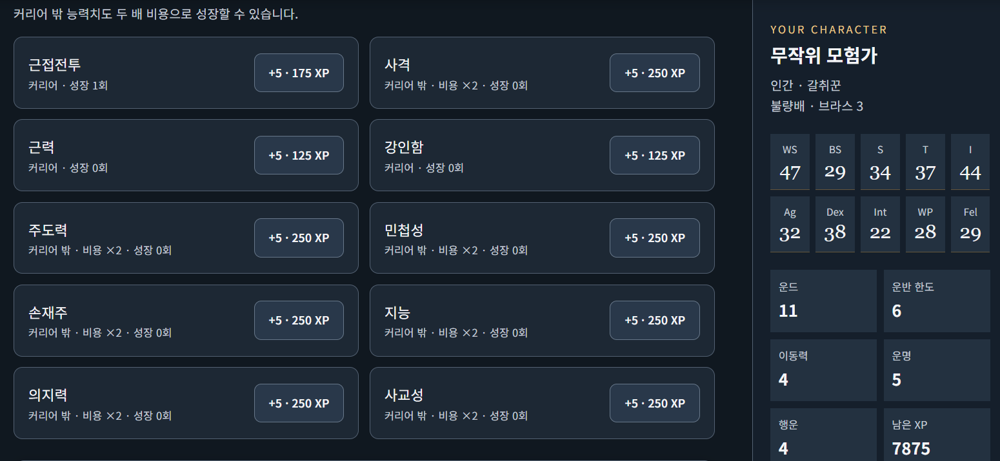
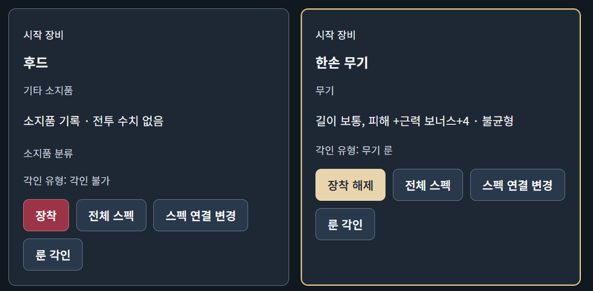
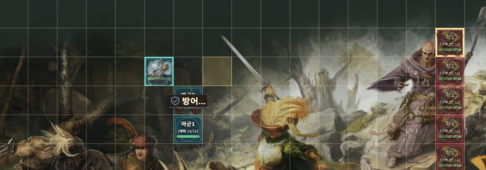

## 프로젝트 목적과 예상 사용자

워해머 TRPG 캐릭터의 생성, XP 성장, 장비·재산 관리와 저장·불러오기를 브라우저에서 처리하는 도구입니다. 제가 TRPG를 플레이하면서 느낀 어려움은 복잡한 규칙을 확인하고 성장에 필요한 XP를 계산해야 한다는 점이었습니다. 이 과정을 줄여 플레이와 캐릭터 구상에 집중할 수 있도록 만드는 것이 목적입니다.

예상 사용자는 캐릭터를 관리하는 기존 플레이어와 GM, 복잡한 규칙 때문에 시작을 망설였던 입문자입니다. 주요 사용 흐름은 캐릭터 생성 → 시트 확인 → 성장·장비 관리 → 저장입니다. 전투 시뮬레이션은 생성한 캐릭터를 활용하는 확장 기능입니다.

## 실행 방법

1. 저장소를 내려받아 압축을 해제하거나 클론합니다.
2. `docs/워해머_캐릭터_공방_전투조작_v49.html`을 크롬이나 엣지에서 엽니다. VS Code에서는 코드가 표시되므로, 파일 탐색기에서 HTML을 브라우저로 여는 방식으로 실행합니다.
3. 함께 제공되는 `docs/art` 등 리소스 폴더가 있다면 위치와 이름을 유지합니다.
4. 시작 화면에서 무작위 생성 또는 수동 생성을 선택합니다. 수동 생성은 종족 → 직업 → 능력치 굴림 → 종족 기술 등의 순서로 진행합니다.

제출본의 기준은 위 v49 파일입니다. 별도 배포 페이지가 있더라도 이 문서의 설명과 확인 범위는 제출한 v49를 기준으로 합니다.

## 주요 기능과 작업 과정

- **캐릭터 생성:** 종족·커리어·능력치·기술·재능·장비를 선택하고 시작 장비와 종족별 특성을 확인합니다.
- **XP 성장:** XP 지급과 소비, 능력치·기술·재능 성장, 성장 기록과 커리어 승급을 관리합니다. 세션에서 얻은 XP로 성장 계획을 세우고 변경된 시트를 다음 세션에 활용하는 것이 목표입니다.
- **장비·재산 관리:** 소지품과 장착 상태, 화폐를 관리하고 장비 효과를 시트에 연결합니다.
- **저장·불러오기:** 캐릭터 정보를 보관하고 다시 사용할 수 있도록 합니다.
- **전투 시뮬레이션:** 전투 조작의 부담을 줄이기 위한 자동전투와 캐릭터 활용 기능을 제공합니다.

먼저 캐릭터 생성과 시트 표시를 구현하고, XP 성장·장비 관리·전투 시뮬레이션으로 범위를 확장했습니다. 장비는 소유와 장착을 구분하고, 장착 결과가 시트와 전투 계산에 반영되도록 요구했습니다. 이후 직접 실행하면서 오류를 찾고 발생 조건과 원하는 결과를 에이전트에게 전달했습니다. 이 기능 목록은 구현 범위이며, 모든 규칙의 정확성을 검증했다는 의미는 아닙니다.

## 실제 에이전트 작업 증거와 검증 결과

**XP 성장**

XP로 성장을 실행한 뒤 촬영한 화면입니다. 근접전투 항목의 ‘성장 1회’와 현재 WS 47, 남은 XP 7875가 표시됩니다. 화면의 ‘+5 · 175 XP’는 촬영 시점에 표시된 다음 성장 버튼의 비용입니다.

**아이템 장착과 그에따른 스텟 연계문제**

한손 무기를 장착한 화면입니다. ‘장착 해제’ 버튼으로 장착 상태를 확인할 수 있고, 피해 ‘근력 보너스+4’와 ‘불균형’ 특성도 표시됩니다. 후드는 별도로 ‘장착’ 버튼이 표시됩니다. 

**전투 시뮬레이션**

전투를 실행한 화면입니다. 격자 전투판에 아군과 적군이 배치되고,
실제 플레이어의 캐릭터 유닛의 체력과 방어 효과가 성공적으로 표시되는 것을 확인할 수 있습니다.

### 검증 결과와 근거 수준

| 항목 | 결과 | 근거와 확인 범위 |
| --- | --- | --- |
| v49 파일 접근 | 파일 경로·실행 방법 확인 | Codex 응답 화면 |
| 브라우저 기본 실행 | 실행 확인 | 사용자 직접 실행 |
| 전투 시뮬레이션 | 격자 전투판·아군·적군·체력·방어 효과 표시 | 사용자 실행 스크린샷 |
| XP 성장 | 근접전투 성장 1회·WS 47·남은 XP 7875 표시 | 사용자 실행 스크린샷; 전후 차감량 비교는 미포함 |
| 아이템 장착 | 한손 무기 장착 상태·피해식·특성 표시 | 사용자 실행 스크린샷; AP·전투 계산 검증과 구분 |
| 반격 3레벨의 같은 턴 3회 발동·횟수 제한 | 통과했다고 보고됨 | 당시 에이전트 응답이며, 현재 제출본의 독립 재검증 결과는 아님 |
| 공격 효과 → 피해·체력 감소 → 사망 연출 | 순서를 확인했다고 보고됨 | 당시 에이전트 응답 |
| 탈것 탑승 효과 | 구현 미완료 | 제출본의 알려진 한계 |

## 효과적이었던 작업 방법 3가지

1. **이미지와 구현 작업의 역할을 나눴습니다.** GPT에는 이미지 생성을, Claude에는 코드 구현을 맡겼습니다. Multica를 활용해 이미지 결과를 구현 작업으로 전달하면서 제가 파일을 옮기거나 작업 환경을 전환하는 부담을 줄였습니다.
2. **발생 상황과 원하는 결과를 구체적으로 설명했습니다.** ‘전투가 이상하다’고만 하지 않고, 이동보다 공격 효과가 먼저 나오거나 피해가 중복 표시되는 상황을 설명했습니다. 이동 → 공격 효과 → 체력 감소처럼 원하는 순서도 전달했습니다.
3. **완료 설명과 실제 파일을 비교했습니다.** 수정됐다는 답변을 받은 뒤 직접 실행하면서 누락과 새로운 오류를 찾아 전달했습니다. 구버전을 기준으로 작업하는 일이 있어, 수정된 버전에 다음 업데이트를 적용하도록 강조했습니다.

## 어려웠던 점 3가지와 대응

1. **규칙을 코드로 옮기는 과정에서 적용 누락이 발생했습니다.** 룰북을 참고하도록 요청했지만 일부 규칙은 실제 플레이에 반영되지 않았습니다. 문제를 발견할 때마다 발생 조건과 기대 동작을 구체적으로 전달하며 수정을 요청했습니다.
2. **대용량 HTML을 업로드하는 데 어려움이 있었습니다.** 기존 업로드 방식에서 문제가 발생해 GitHub Desktop으로 파일을 커밋하고 푸시하는 방식으로 대응했습니다.
3. **시트와 전투 계산의 연동이 어려웠습니다.** 장비 장착으로 바뀐 수치나 캐릭터의 재능이 전투에 반영되지 않는 사례가 있었습니다. 장착 상태·시트 수치·전투 결과의 관계를 구체적인 사례로 지적하며 수정 작업을 진행했습니다.

## 알려진 한계

- 말이나 드래곤 등 탈것에 탑승할 때 달라지는 무기 피해와 타격 규칙은 구현을 완료하지 못했습니다.
- 모든 규칙·장비·재능 조합과 자동전투 판단의 정확성을 보장하지 않습니다. 특히 시트와 전투 계산의 연동은 추가 점검이 필요합니다.
- 기본 실행과 성장·장착·전투 화면을 직접 확인했지만, 계산 전후 비교와 전체 기능의 회귀 검증 결과는 확보하지 못했습니다.

## 채점 대상 핵심 소스 파일

- `docs/워해머_캐릭터_공방_전투조작_v49.html`: 캐릭터 생성, XP 성장, 장비 관리, 시트와 전투 시뮬레이션의 주요 구현입니다. HTML·CSS·JavaScript가 하나의 파일에 포함되어 있으며, 이 파일을 주요 채점 대상으로 지정합니다.
